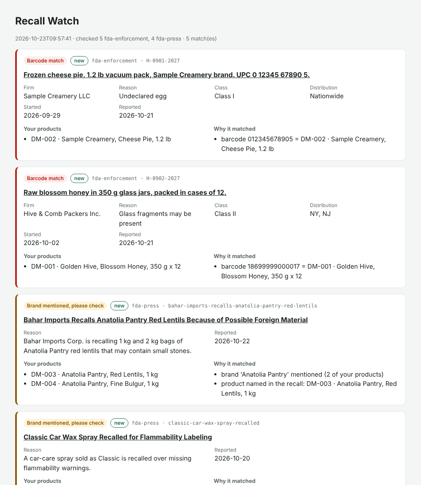

# recall-watch

**Every morning, check the FDA's food recalls against the products you sell, and get an email when one matches.**

Food distributors, importers and grocers must act quickly when a product they carry is recalled: pull it from shelves and warehouses, and tell their customers. In many small businesses this depends on someone remembering to read the FDA website. `recall-watch` does it automatically, for free, using GitHub Actions: no server, no database, no mail account.



## How it decides a recall is yours

| Match | When | What to do |
|---|---|---|
| **Barcode match** | A UPC/EAN/GTIN printed in the recall equals one of your product or case barcodes | Almost certainly your product: act |
| **Brand mentioned, please check** | Your brand appears as a whole phrase in the recall | A person should look: the recall may cover other items of that brand |

Details that make the matching trustworthy:

- **Barcodes are read the way recalls write them.** `UPC 094922980045` and `UPC 6 66186 27762 1` are both found. Every candidate must pass the GS1 check digit, so lot numbers, dates and phone numbers of the same length are ignored.
- **Case barcodes count.** A GTIN-14 on a case is linked to the item it contains, so a recall that lists only the case code still finds your unit.
- **Brand matches rank the right product first.** If the recall names "red lentils", your red lentils are listed above the brand's other items.
- **Common-word brands can be skipped.** Brands such as *Classic* or *Gold* would match unrelated recalls; list them in `products/ignore-brands.txt` and only their barcodes are used.
- **Each recall alerts once.** Reported recall IDs are stored in `state/seen.json` (IDs and dates only, never product data). If a notification fails, the recall is retried on the next run.

## Data sources

| Source | Speed | Detail |
|---|---|---|
| [openFDA food enforcement reports](https://open.fda.gov/apis/food/enforcement/) | Weekly. A recall appears only after FDA classifies it, often several weeks after it starts | Product description, lot and UPC codes, reason, Class I/II/III, distribution |
| [FDA recalls press-release feed](https://www.fda.gov/safety/recalls-market-withdrawals-safety-alerts) | Same day, for recalls FDA announces publicly | Title and summary only; latest ~20 items |

The two complement each other: press releases are fast but rarely include barcodes; enforcement reports are slow but complete.

**This is not an official alert service.** openFDA states that its data should not be used to issue public alerts or to track a recall's lifecycle, and not every recall gets a press release. Use `recall-watch` as an internal early warning and always confirm on fda.gov before acting. Meat, poultry and egg products are regulated by USDA FSIS, which this version does not check yet.

## Set it up for your business (10 minutes, free)

1. **Make a private copy.** On this repository click **Use this template → Create a new repository** and choose **Private**. Your product list must never be in a public repository.
2. **Add your product list.** Export it from your ERP or spreadsheet as `products/products.csv` (or `.xlsx`) with a name, barcode and optionally brand, case barcode and SKU column ([accepted headers](products/README.md)). Upload it on GitHub with **Add file → Upload files** into the `products` folder.
3. **Turn on notifications.** In your copy, go to **Watch → All activity** (or **Custom → Issues**). Each new match opens an issue, and GitHub emails you about it.
4. **Run it once.** **Actions → Recall check → Run workflow**. After that it runs every morning on its own.

Before putting a company product list into any GitHub account, check that your company allows it.

Optional: to also post to Slack, Microsoft Teams or Discord, add the webhook URL as a repository secret named `RECALL_WEBHOOK_URL`.

## Run it on your computer

```bash
git clone https://github.com/eyildirim61/recall-watch.git
cd recall-watch
python3 -m venv .venv && source .venv/bin/activate
python -m pip install --upgrade pip && pip install -e ".[dev,xlsx]"

# Demo with the included example data (offline)
recall-watch check --products examples/products.csv \
  --recorded examples/enforcement.json --recorded examples/press.xml --dry-run

# Real check against live FDA data
recall-watch check --products my-products.csv --days 60
open reports/report.html
```

Options: `--source fda-enforcement|fda-press`, `--days N`, `--ignore-brand X`, `--ignore-brands-file F`, `--no-brand-from-name`, `--github-issues`, `--webhook-url URL`, `--dry-run`, `--fail-on-match`.

The example files in `examples/` are **synthetic**: fictional firms and barcodes in the exact format of the real feeds.

## How it is built

| File | Role |
|---|---|
| `sources.py` | openFDA client (date window, paging, 404 = no results, retries) and RSS parser |
| `gtin.py` | Finds barcodes in free text, validates check digits, links case codes to items |
| `products.py` | Reads CSV/XLSX product lists, including Odoo exports and Turkish headers |
| `match.py` | Barcode and brand matching, ranking, evidence for each match |
| `state.py` | Remembers reported recalls |
| `notify.py` | GitHub issues and webhooks |
| `report.py` | HTML report, JSON, Markdown summary for the Actions page |

Standard library only (`openpyxl` is optional for Excel files). Network code is tested with recorded responses, so `pytest` runs offline.

## Roadmap

- [ ] USDA FSIS recalls (meat, poultry, egg products)
- [ ] Canadian (CFIA) and EU (RASFF) recall feeds
- [ ] Weekly digest email instead of one issue per recall

## License

MIT. Recall data provided by the U.S. Food and Drug Administration ([open.fda.gov](https://open.fda.gov)).
